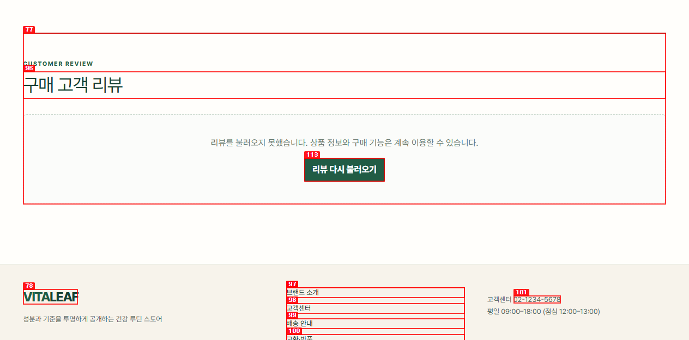
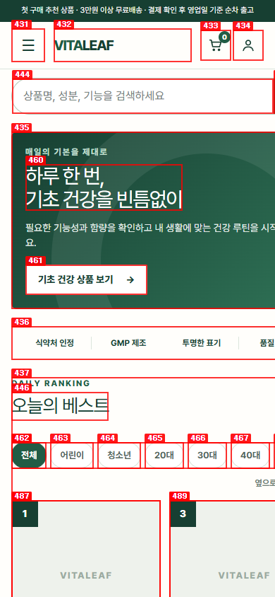

# Dogfood Report: VITALEAF

| Field | Value |
|-------|-------|
| **Date** | 2026-11-06 |
| **App URL** | https://vitaleaf.vercel.app |
| **Session** | vitaleaf-audit |
| **Scope** | Storefront, authentication, cart/checkout, order lookup, customer support, administrator |

## Summary

| Severity | Count |
|----------|-------|
| Critical | 0 |
| High | 0 |
| Medium | 4 |
| Low | 1 |
| **Total** | **5** |

## Issues

### ISSUE-001: 상품 상세 리뷰를 불러오지 못함

| Field | Value |
|-------|-------|
| **Severity** | medium |
| **Category** | functional |
| **URL** | https://vitaleaf.vercel.app/products/sample-daily-multivitamin |
| **Repro Video** | N/A |
| **Status** | 로컬 수정 및 회귀 테스트 완료 |

**Description**

상품 상세 진입 시 구매 고객 리뷰 대신 `리뷰를 불러오지 못했습니다` 오류가 표시됩니다. `리뷰 다시 불러오기`를 눌러도 동일 오류가 재현됩니다. 상품 정보와 구매는 가능하지만 구매 의사결정에 필요한 후기 정보를 확인할 수 없습니다.

**Repro Steps**

1. 상품 상세 페이지에 진입하고 구매 고객 리뷰 영역을 확인합니다.
   

2. `리뷰 다시 불러오기`를 눌러도 동일 메시지가 다시 표시됩니다.

**Resolution**

실제 Firestore 오류가 요구한 `approved ASC + productId ASC + createdAt DESC` 복합 인덱스를 추가하고, 동일 인덱스가 삭제되면 실패하는 설정 계약 테스트를 추가했습니다.

---

### ISSUE-002: 모바일 홈의 보조 텍스트 명암 대비 부족

| Field | Value |
|-------|-------|
| **Severity** | medium |
| **Category** | accessibility |
| **URL** | https://vitaleaf.vercel.app/ |
| **Repro Video** | N/A |
| **Status** | 로컬 수정 및 axe 재검사 완료 |

**Description**

axe-core WCAG 2 AA 검사에서 상품 카드의 카테고리, 이미지 대체 문구, 가로 스크롤 안내 등 29개 노드가 최소 명암비 4.5:1을 충족하지 못했습니다. 실제 측정값은 2.12:1~4.08:1입니다.

**Repro Steps**

1. 390×844 모바일 화면으로 홈을 열고 상품 카드의 보조 문구를 확인합니다.
   

2. axe-core WCAG 2 AA 검사에서 `color-contrast` serious 위반 1종, 29개 노드가 보고됩니다.

**Resolution**

해당 보조 텍스트와 푸터 관리자 링크의 색상을 최소 명암비 이상으로 조정했습니다. 동일 모바일 화면의 재검사 결과 axe 위반은 0건입니다.

---

### ISSUE-003: 관리자 로딩 화면의 랜드마크 역할 충돌

| Field | Value |
|-------|-------|
| **Severity** | medium |
| **Category** | accessibility |
| **URL** | https://vitaleaf.vercel.app/admin |
| **Status** | 로컬 수정 및 컴포넌트 테스트 완료 |

**Description**

관리자 권한 확인 중 `main` 요소 자체에 `role="status"`가 지정되어 기본 `main` 랜드마크 의미가 사라지고 axe의 `aria-allowed-role` 검사에 걸렸습니다.

**Resolution**

`main` 랜드마크는 유지하고 내부 문단만 상태 영역으로 노출하도록 변경했습니다. 관리자 대시보드와 상품 초안 미리보기 테스트가 이 구조를 보장합니다.

---

### ISSUE-004: 사이트 아이콘 요청이 404로 실패

| Field | Value |
|-------|-------|
| **Severity** | low |
| **Category** | browser metadata |
| **URL** | https://vitaleaf.vercel.app/favicon.ico |
| **Status** | 로컬 수정 및 HTTP 200 확인 |

**Description**

사이트 아이콘 메타데이터가 없어 브라우저의 기본 `/favicon.ico` 요청이 404로 실패했습니다.

**Resolution**

Next.js App Router의 `app/icon.svg` 규약으로 브랜드 아이콘을 추가했습니다. 생성된 아이콘 링크와 `/icon.svg` 응답 200을 확인했습니다.

---

### ISSUE-005: 관리자 문의 화면 설명 문구 명암 대비 부족

| Field | Value |
|-------|-------|
| **Severity** | medium |
| **Category** | accessibility |
| **URL** | https://vitaleaf.vercel.app/admin |
| **Status** | 수정 및 재검증 예정 |

**Description**

프로덕션 관리자 문의 화면의 설명 문구가 배경 대비 4.11:1로 WCAG 2 AA 최소 기준 4.5:1을 충족하지 못했습니다.

**Resolution**

관리자 도구 모음 설명 문구의 공통 색상을 이미 검증된 진한 보조 텍스트 색상으로 조정했습니다.

---
